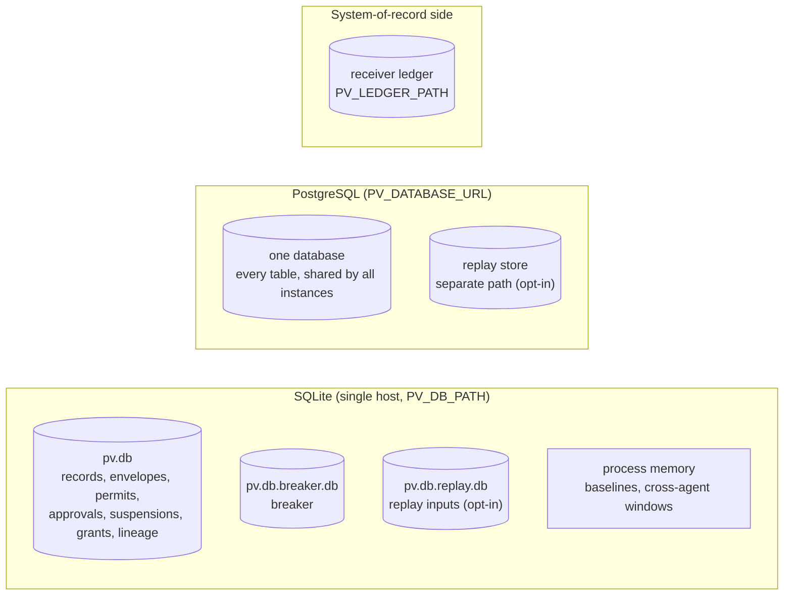

# Data: every ledger table

Where PrivateVault keeps state, who writes it, who reads it, and where it
lives on each backend. `test_every_table_is_documented` fails if code
creates a table that is not in the tables below.

## Where the data lives

With `PV_DATABASE_URL` set, every instance behind a load balancer uses the
same database, so permits, approvals, breaker budgets, baselines and
cross-agent windows are enforced across instances
([../benchmarks/MULTI-INSTANCE.md](../benchmarks/MULTI-INSTANCE.md)). On
SQLite, run one instance. The replay store is always separate, because it
retains raw request fields (privacy boundary).

## Decision evidence

| Table | Written by | Read by | Purpose |
|---|---|---|---|
| `records` | `agent_dna/decision_recorder.py::DecisionRecorder.record`, `agent_dna/decision_recorder.py::DecisionRecorder.report_outcome` | `/v1/records`, `/v1/verify`, `/v1/audit/export`, `agent_dna/decision_recorder.py::DecisionRecorder.restore_chains`, backups | Hash-chained decision records and execution events, per agent |
| `envelopes` | same transaction as `records` | `/v1/envelope`, `/v1/audit/envelopes`, `tools/verify_records.py` | Signed envelope of each record |

Code: `agent_dna/sqlite_store.py::SQLiteDecisionStore`,
`agent_dna/pg_store.py::PostgresDecisionStore`. Record and envelope commit
together or not at all; on PostgreSQL the per-agent chain head is taken
under an advisory lock so concurrent instances cannot fork a chain.

## Single-use claims

| Table | Written by | Read by | Purpose |
|---|---|---|---|
| `execution_authorization_mint` | `/v1/authorize` via `claim_or_replay_mint` | `/v1/authorize`, revocation scan | One live permit per decision (ADR 0016) |
| `execution_authorization_consume` | the sidecar via `try_consume_unless_suspended` | the sidecar, `decision_execution_status` | A permit is used at most once (ADR 0004) |
| `approval_consume` | `agent_dna/approval_bridge.py::ApprovalBridge.consider` via `try_consume_approval` | the approval bridge | An approval is used at most once (ADR 0020); `not_after` keeps its verified expiry, which caps the permit (ADR 0024) |
| `suspensions` | `agent_dna/grant_revocation.py::GrantRevocationLedger.revoke`, late-revocation path of `/v1/authorize` | the sidecar (same transaction as consume), `/v1/revocations` | Permits, agents or organisations that must not dispatch |

## Grants

| Table | Written by | Read by | Purpose |
|---|---|---|---|
| `grant_spend` | `agent_dna/grant_spend.py::GrantSpendLedger`, `agent_dna/pg_store.py::PostgresGrantSpendLedger` | the authorization level of the ladder | Cumulative spend per grant against its budget |
| `grant_revocations` | `pv grants revoke` (`agent_dna/cli.py::cmd_grants_revoke`) | decide, `/v1/authorize`, `/v1/revocations` | Durable revocations with who and why |

## Enforcement state

| Table | Written by | Read by | Purpose |
|---|---|---|---|
| `breaker_events` | `agent_dna/circuit_breaker.py::CircuitBreaker.reserve`, `agent_dna/circuit_breaker.py::CircuitBreaker.finalize` | the breaker | Decisions and amounts in the sliding window |
| `breaker_state` | the breaker | `agent_dna/circuit_breaker.py::CircuitBreaker.is_tripped` | Tripped or not |
| `breaker_log` | trips and `agent_dna/circuit_breaker.py::CircuitBreaker.reset` | `agent_dna/circuit_breaker.py::CircuitBreaker.verify_log` | Hash-linked trip and reset history |
| `agent_baselines` | `agent_dna/pg_shared_state.py::PostgresAgentBaselines` (PostgreSQL only) | drift scoring | Last ALLOWed capability per agent |
| `cabi_executions` | `agent_dna/pg_shared_state.py::PostgresWindows` (PostgreSQL only) | cross-agent invariants | Recency of each declared execution (LRU) |
| `cabi_events` | `agent_dna/pg_shared_state.py::PostgresWindows` (PostgreSQL only) | cross-agent invariants | Interaction events per execution |

On SQLite the last three live in process memory with the same semantics.
On PostgreSQL the breaker and lineage reuse their SQLite code through
`agent_dna/pg_compat.py::PgCompatConnection`.

## Lineage (ADR 0021)

| Table | Written by | Read by | Purpose |
|---|---|---|---|
| `lineage_events` | `agent_dna/lineage.py::LineageLedger.record` | `/v1/lineage`, `/v1/flows`, `tools/verify_lineage.py` | Signed, server-derived lineage of each decision |
| `lineage_dual_control` | `agent_dna/lineage.py::LineageLedger.claim_approval` | lineage resolution | An initiate is approved at most once |

## Policy replay (opt-in)

| Table | Written by | Read by | Purpose |
|---|---|---|---|
| `replay_inputs` | `agent_dna/policy_replay.py::ReplayInputStore` (when `PV_REPLAY_FIELDS` is set) | `pv policy check --history-db` retrospective replay (`agent_dna/policy_replay.py::PolicyReplay`) | Selected raw request fields, kept apart from the evidence |

## Receiver side

Owned by the system of record, not by PrivateVault.

| Table | Written by | Read by | Purpose |
|---|---|---|---|
| `receiver_consume` | `agent_dna/receiver/ledger.py::ReceiverLedger.record` | `agent_dna/receiver/ledger.py::ReceiverLedger.is_consumed` | A permit is admitted at most once at the receiver |
| `receiver_receipts` | `agent_dna/receiver/ledger.py::ReceiverLedger.record` | `network/receiver_kit/export_receipts.py`, `tools/verify_receiver_receipts.py` | Signed, hash-chained receipt of every evaluated request |
| `receiver_transactions` | `agent_dna/receiver/ledger.py::ReceiverLedger.record`, `record_outcome`, `resolve_transaction` | `ReceiverLedger.record` (duplicate check), `tools/receiver_transactions.py` | One claim per declared business transaction key and its state (ADR 0030) |
| `receiver_transaction_events` | the same three methods | `tools/receiver_transactions.py history` | Append-only history of every claim, upstream answer and reconciliation |

## Backups

`agent_dna/backup.py` backs up the PrivateVault database (SQLite file or
PostgreSQL dump from one exported snapshot) with a signed manifest of row
counts and digests per table, and proves a restore against it. Runbook:
[../operations/BACKUP.md](../operations/BACKUP.md).
