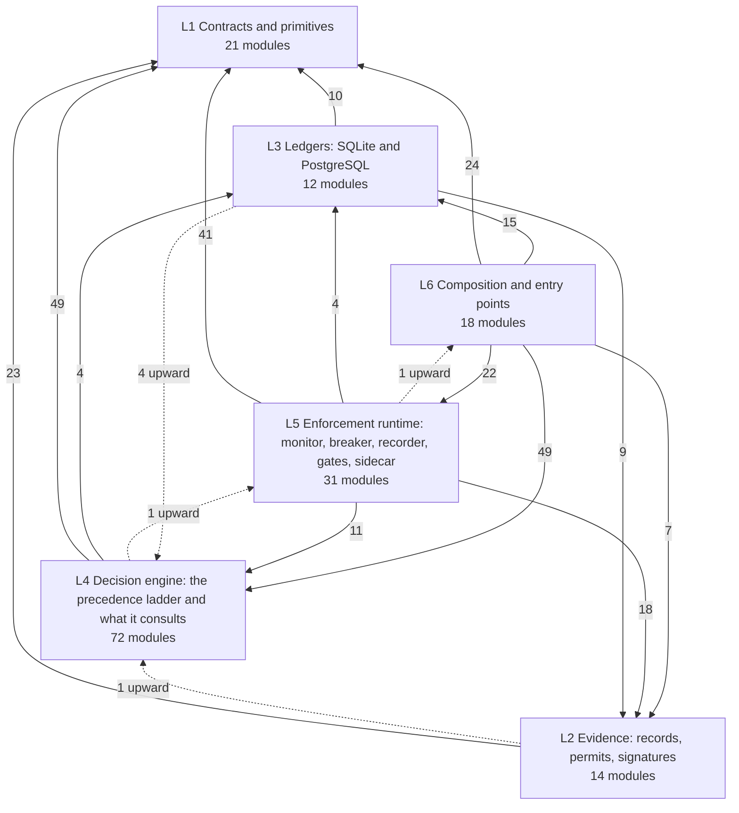

# Who depends on whom (generated)

<!-- GENERATED by tools/depmap.py from docs/architecture/modules.json. Do not edit. Regenerate: python tools/archmap.py && python tools/depmap.py -->

The runtime core (`agent_dna/`, `api/`) arranged in six responsibility layers,
bottom to top. A module may use anything in its own layer or below. Arrows
point from the importing layer to the imported one; the number is how many
module-to-module imports cross that way. Imports that point *up* a layer are
listed at the end. For directories outside the core (tools, examples,
experimental) see [MAP.md](MAP.md).

## L6: Composition and entry points

| Module | What it is | Depends on (core) | Used by |
|---|---|---|---|
| `agent_dna` | Public Python API for PrivateVault Agent DNA | `agent_dna.advisory`, `agent_dna.allowlist`, `agent_dna.authorization`, `agent_dna.change_management`, `agent_dna.confidence`, `agent_dna.decision`, `agent_dna.diff`, `agent_dna.discovery`, `agent_dna.dynamics`, `agent_dna.fingerprint`, `agent_dna.invariant_engine`, `agent_dna.invariants`, `agent_dna.manifold`, `agent_dna.profile_store`, `agent_dna.reference_policies`, `agent_dna.runtime`, `agent_dna.scorer`, `agent_dna.security`, `agent_dna.similarity`, `agent_dna.timeline`, `agent_dna.trace` | none |
| `agent_dna.audit_connector` | PrivateVault Audit: read-only remote MCP server over the audit-scope API | `agent_dna.audit_connector.client`, `agent_dna.audit_connector.server` | none |
| `agent_dna.audit_connector.__main__` | Run PrivateVault Audit as a Streamable HTTP MCP server | `agent_dna.audit_connector.client`, `agent_dna.audit_connector.server` | none |
| `agent_dna.audit_connector.client` | Read-only HTTP client for PrivateVault's audit surface | nothing in the core | 4: `agent_dna.audit_connector`, `agent_dna.audit_connector.__main__`, `agent_dna.audit_connector.oauth`, `agent_dna.audit_connector.server` |
| `agent_dna.audit_connector.oauth` | OAuth 2.0 for the PrivateVault Audit connector | `agent_dna.audit_connector.client` | 1: `agent_dna.audit_connector.server` |
| `agent_dna.audit_connector.server` | PrivateVault Audit: a read-only remote MCP server for risk and audit teams | `agent_dna.audit_connector.client`, `agent_dna.audit_connector.oauth` | 2: `agent_dna.audit_connector`, `agent_dna.audit_connector.__main__` |
| `agent_dna.backup` | Backups of the PrivateVault ledgers, and restores that prove themselves | `agent_dna.authority_v01`, `agent_dna.key_custody`, `agent_dna.pg_store`, `agent_dna.sqlite_store` | none |
| `agent_dna.cli` | pv — PrivateVault command line | `agent_dna.authority_v01`, `agent_dna.discovery`, `agent_dna.grant_revocation`, `agent_dna.pg_store`, `agent_dna.policy_gate`, `agent_dna.policy_miner`, `agent_dna.policy_replay`, `agent_dna.security.loop_discovery`, `agent_dna.sqlite_store` | none |
| `agent_dna.composition` | Production composition root (audit Commit set 3) | `agent_dna.adapters`, `agent_dna.adapters_policy.opa`, `agent_dna.apikeys`, `agent_dna.approval_bridge`, `agent_dna.authority_v01`, `agent_dna.circuit_breaker`, `agent_dna.connector`, `agent_dna.connector.adapters.exact_byte_http`, `agent_dna.connector.adapters.execution_trust`, `agent_dna.connector.adapters.sidecar_transport`, `agent_dna.connector.cross_agent`, `agent_dna.consensus`, `agent_dna.decision`, `agent_dna.decision_recorder`, `agent_dna.dynamics`, `agent_dna.economics`, `agent_dna.grant_revocation`, `agent_dna.grant_spend`, `agent_dna.grants`, `agent_dna.key_custody`, `agent_dna.manifold`, `agent_dna.open_authorizer`, `agent_dna.pg_compat`, `agent_dna.pg_shared_state`, `agent_dna.pg_store`, `agent_dna.policy.checker`, `agent_dna.policy.loader`, `agent_dna.policy_replay`, `agent_dna.runtime`, `agent_dna.scorer`, `agent_dna.signer_python`, `agent_dna.sqlite_store`, `agent_dna.trace`, `agent_dna.uaal_layer` | 3: `agent_dna.gateway.__main__`, `agent_dna.gateway.runtime`, `api.server` |
| `agent_dna.discovery` | Offline, low-compute discovery loop for PrivateVault controls | `agent_dna.policy.checker`, `agent_dna.policy.schema`, `agent_dna.policy_gate`, `agent_dna.policy_miner`, `agent_dna.security.loop_discovery`, `agent_dna.validation.metrics` | 2: `agent_dna`, `agent_dna.cli` |
| `agent_dna.gateway.__main__` | Out-of-process MCP / HTTPS-egress gateway | `agent_dna.composition`, `agent_dna.gateway.credentials`, `agent_dna.gateway.errors`, `agent_dna.gateway.framing`, `agent_dna.gateway.http_sse_proxy`, `agent_dna.gateway.https_egress`, `agent_dna.gateway.runtime`, `agent_dna.gateway.stdio_proxy` | none |
| `agent_dna.key_lifecycle` | Key rotation as a governed action | `agent_dna.decision`, `agent_dna.signer`, `agent_dna.trace` | none |
| `agent_dna.mcp_public_verifier` | Public MCP server exposing ONLY the independent DRP verifier as a | nothing in the core | none |
| `agent_dna.scan` | Read-only analysis of logs a customer already has | `agent_dna.scan.ingest`, `agent_dna.scan.replay` | none |
| `agent_dna.scan.ingest` | Normalize heterogeneous agent logs into AgentAction | `agent_dna.trace` | 2: `agent_dna.scan`, `agent_dna.scan.replay` |
| `agent_dna.scan.inventory` | What the agents in a log can actually do | `agent_dna.trace` | none |
| `agent_dna.scan.replay` | Replay a customer's own log through the engine, enforcing nothing | `agent_dna.decision`, `agent_dna.dynamics`, `agent_dna.manifold`, `agent_dna.open_authorizer`, `agent_dna.scan.ingest`, `agent_dna.scorer`, `agent_dna.trace` | 1: `agent_dna.scan` |
| `api.server` | PrivateVault Agent DNA — Decision Security API | `agent_dna.action_v01`, `agent_dna.apikeys`, `agent_dna.approval_bridge`, `agent_dna.authority_deadline`, `agent_dna.authority_v01`, `agent_dna.authorize_binding`, `agent_dna.composition`, `agent_dna.connector.cross_agent`, `agent_dna.control_posture`, `agent_dna.decision`, `agent_dna.decision_graph`, `agent_dna.dispatch_context_v01`, `agent_dna.execution_v01`, `agent_dna.key_custody`, `agent_dna.lineage`, `agent_dna.observability.logger`, `agent_dna.observability.metrics`, `agent_dna.observability.prometheus_bridge`, `agent_dna.operation_registry`, `agent_dna.permit_evidence`, `agent_dna.presenter_identity`, `agent_dna.request_bounds`, `agent_dna.revocation_list`, `agent_dna.runtime`, `agent_dna.security.loop_discovery`, `agent_dna.signer`, `agent_dna.trace`, `agent_dna.wire_serialization_v01` | none |

## L5: Enforcement runtime: monitor, breaker, recorder, gates, sidecar

| Module | What it is | Depends on (core) | Used by |
|---|---|---|---|
| `agent_dna.apikeys` | API key auth for the pilot deployment. Deliberately minimal: | `agent_dna.identity` | 3: `agent_dna.composition`, `agent_dna.connector.middleware`, `api.server` |
| `agent_dna.approval_bridge` | Approval bridge (ADR 0020): a verified, single-use human approval turns | `agent_dna.approval_v01`, `agent_dna.authority_v01`, `agent_dna.identity` | 4: `agent_dna.authority_deadline`, `agent_dna.composition`, `agent_dna.decision`, `api.server` |
| `agent_dna.authority_deadline` | How long a sealed ALLOW may still be turned into a permit | `agent_dna.approval_bridge` | 1: `api.server` |
| `agent_dna.circuit_breaker` | Circuit breaker (TUE-05 / RBM-06) | `agent_dna.amount`, `agent_dna.decision`, `agent_dna.grant_spend`, `agent_dna.pg_compat` | 2: `agent_dna.composition`, `agent_dna.runtime` |
| `agent_dna.connector` |  | `agent_dna.connector.middleware`, `agent_dna.connector.models` | 1: `agent_dna.composition` |
| `agent_dna.connector.adapters` |  | `agent_dna.connector.adapters.exact_byte_http`, `agent_dna.connector.adapters.mcp` | none |
| `agent_dna.connector.adapters.conformance` | Minimal dispatch-adapter conformance contract | nothing in the core | none |
| `agent_dna.connector.adapters.exact_byte_http` | Exact-byte egress dispatcher — sidecar last meter after mint | `agent_dna.authority_v01`, `agent_dna.authorize_binding`, `agent_dna.closure_v01`, `agent_dna.connector.adapters.execution_trust`, `agent_dna.connector.adapters.sidecar_transport`, `agent_dna.dispatch_v01`, `agent_dna.execution_v01`, `agent_dna.key_custody`, `agent_dna.receiver.permit_header` | 2: `agent_dna.composition`, `agent_dna.connector.adapters` |
| `agent_dna.connector.adapters.execution_trust` | Deployment-owned execution trust bundle | `agent_dna.authority_v01` | 2: `agent_dna.composition`, `agent_dna.connector.adapters.exact_byte_http` |
| `agent_dna.connector.adapters.mcp` | MCP adapter — wraps an MCPServer so EVERY tools/call routes | `agent_dna.connector.models` | 1: `agent_dna.connector.adapters` |
| `agent_dna.connector.adapters.sidecar_transport` | Sidecar-owned egress transport | `agent_dna.presenter_identity` | 2: `agent_dna.composition`, `agent_dna.connector.adapters.exact_byte_http` |
| `agent_dna.connector.cross_agent` | Cross-agent invariant enforcement (CABI) for the connector and HTTP API | `agent_dna.advisory`, `agent_dna.control_posture`, `agent_dna.decision`, `agent_dna.identity`, `agent_dna.multi_agent`, `agent_dna.multi_agent.base`, `agent_dna.multi_agent.dual_control`, `agent_dna.multi_agent.invariant_engine`, `agent_dna.multi_agent.runtime_validator` | 3: `agent_dna.composition`, `agent_dna.connector.middleware`, `api.server` |
| `agent_dna.connector.middleware` | ConnectorMiddleware — the single enforcement path for every harness | `agent_dna.apikeys`, `agent_dna.authority_v01`, `agent_dna.connector.cross_agent`, `agent_dna.connector.models`, `agent_dna.control_posture`, `agent_dna.dispatch_context_v01`, `agent_dna.runtime`, `agent_dna.trace` | 3: `agent_dna.connector`, `agent_dna.gateway.https_egress`, `agent_dna.gateway.mediator` |
| `agent_dna.decision_recorder` | DecisionRecorder — the single seam between enforcement and audit | `agent_dna.decision`, `agent_dna.decision_graph`, `agent_dna.decision_record`, `agent_dna.execution_record`, `agent_dna.trace` | 1: `agent_dna.composition` |
| `agent_dna.gateway` | Inline MCP gateway — mediated egress with detectable bypass | `agent_dna.gateway.errors`, `agent_dna.gateway.framing`, `agent_dna.gateway.runtime` | none |
| `agent_dna.gateway.credentials` | Upstream credential isolation | `agent_dna.gateway.errors` | 5: `agent_dna.gateway.__main__`, `agent_dna.gateway.https_egress`, `agent_dna.gateway.mediator`, `agent_dna.gateway.runtime`, `agent_dna.gateway.upstream` |
| `agent_dna.gateway.framing` | MCP JSON-RPC framing and exact-byte serialization | `agent_dna.authority_v01`, `agent_dna.execution_v01`, `agent_dna.gateway.errors`, `agent_dna.gateway.protocol` | 8: `agent_dna.gateway`, `agent_dna.gateway.__main__`, `agent_dna.gateway.http_sse_proxy`, `agent_dna.gateway.https_egress`, `agent_dna.gateway.mediator`, ... |
| `agent_dna.gateway.http_sse_proxy` | HTTP/SSE MCP proxy — same mediation semantics as stdio | `agent_dna.gateway.errors`, `agent_dna.gateway.framing`, `agent_dna.gateway.mediator`, `agent_dna.gateway.runtime` | 1: `agent_dna.gateway.__main__` |
| `agent_dna.gateway.https_egress` | Named HTTPS egress — same freeze/decide/verify story as MCP | `agent_dna.connector.middleware`, `agent_dna.connector.models`, `agent_dna.execution_v01`, `agent_dna.gateway.credentials`, `agent_dna.gateway.errors`, `agent_dna.gateway.framing`, `agent_dna.gateway.upstream` | 2: `agent_dna.gateway.__main__`, `agent_dna.gateway.runtime` |
| `agent_dna.gateway.mediator` | Tool-call mediation: decide → freeze bytes → forward → outcome | `agent_dna.connector.middleware`, `agent_dna.connector.models`, `agent_dna.execution_v01`, `agent_dna.gateway.credentials`, `agent_dna.gateway.errors`, `agent_dna.gateway.framing`, `agent_dna.gateway.metrics`, `agent_dna.gateway.protocol`, `agent_dna.gateway.session`, `agent_dna.gateway.upstream` | 2: `agent_dna.gateway.http_sse_proxy`, `agent_dna.gateway.runtime` |
| `agent_dna.gateway.metrics` | Gateway metrics — never authorize; labels must never carry secrets | nothing in the core | 2: `agent_dna.gateway.mediator`, `agent_dna.gateway.runtime` |
| `agent_dna.gateway.protocol` | MCP method classification and JSON-RPC id correlation | `agent_dna.gateway.errors` | 2: `agent_dna.gateway.framing`, `agent_dna.gateway.mediator` |
| `agent_dna.gateway.runtime` | Gateway process entry — refuses to start without a production runtime | `agent_dna.composition`, `agent_dna.gateway.credentials`, `agent_dna.gateway.errors`, `agent_dna.gateway.framing`, `agent_dna.gateway.https_egress`, `agent_dna.gateway.mediator`, `agent_dna.gateway.metrics`, `agent_dna.gateway.session`, `agent_dna.gateway.upstream` | 4: `agent_dna.gateway`, `agent_dna.gateway.__main__`, `agent_dna.gateway.http_sse_proxy`, `agent_dna.gateway.stdio_proxy` |
| `agent_dna.gateway.session` | Per-connection session identity for bypass measurement | nothing in the core | 2: `agent_dna.gateway.mediator`, `agent_dna.gateway.runtime` |
| `agent_dna.gateway.stdio_proxy` | Stdio MCP proxy loop — client stdin/stdout speak MCP; we mediate | `agent_dna.gateway.errors`, `agent_dna.gateway.framing`, `agent_dna.gateway.runtime` | 1: `agent_dna.gateway.__main__` |
| `agent_dna.gateway.upstream` | Upstream transports — the only place credentials are applied | `agent_dna.gateway.credentials`, `agent_dna.gateway.errors`, `agent_dna.gateway.framing` | 3: `agent_dna.gateway.https_egress`, `agent_dna.gateway.mediator`, `agent_dna.gateway.runtime` |
| `agent_dna.receiver` | Receiver-side enforcement: the system of record refuses unpermitted actions | `agent_dna.receiver.asgi`, `agent_dna.receiver.gate`, `agent_dna.receiver.ledger`, `agent_dna.receiver.permit_header`, `agent_dna.receiver.receipts` | none |
| `agent_dna.receiver.asgi` | HTTP deployment shapes for ``ReceiverGate`` | `agent_dna.authority_v01`, `agent_dna.receiver.gate`, `agent_dna.receiver.permit_header`, `agent_dna.receiver.tls` | 1: `agent_dna.receiver` |
| `agent_dna.receiver.gate` | Receiver gate: enforcement at the system of record, not at the agent | `agent_dna.authority_v01`, `agent_dna.execution_v01`, `agent_dna.key_custody`, `agent_dna.presenter_identity`, `agent_dna.receiver.ledger`, `agent_dna.receiver.permit_header`, `agent_dna.receiver.receipts`, `agent_dna.revocation_list`, `agent_dna.wire_serialization_v01` | 2: `agent_dna.receiver`, `agent_dna.receiver.asgi` |
| `agent_dna.receiver.tls` | mTLS for the receiver gate: who presented the permit (ADR 0022) | `agent_dna.presenter_identity` | 1: `agent_dna.receiver.asgi` |
| `agent_dna.runtime` | Streaming Runtime Monitor | `agent_dna.advisory`, `agent_dna.circuit_breaker`, `agent_dna.decision`, `agent_dna.observability.metrics`, `agent_dna.shell_guard`, `agent_dna.trace` | 4: `agent_dna`, `agent_dna.composition`, `agent_dna.connector.middleware`, `api.server` |

## L4: Decision engine: the precedence ladder and what it consults

| Module | What it is | Depends on (core) | Used by |
|---|---|---|---|
| `agent_dna.adapters` | Adapters: how real and synthetic traces get into Agent DNA | `agent_dna.trace` | 1: `agent_dna.composition` |
| `agent_dna.adapters_framework` | Evidence adapter framework — the pattern any future data-source | `agent_dna.adapters_framework.base` | none |
| `agent_dna.adapters_framework.base` | EvidenceAdapter base class | `agent_dna.decision`, `agent_dna.trace` | 1: `agent_dna.adapters_framework` |
| `agent_dna.adapters_policy` | Policy Adapter Layer — consumes existing enterprise policies | `agent_dna.adapters_policy.local`, `agent_dna.adapters_policy.opa`, `agent_dna.adapters_policy.skill_adapter` | none |
| `agent_dna.adapters_policy.git_bundle` | DEPRECATED shim — GitBundleAdapter is experimental, not core | nothing in the core | none |
| `agent_dna.adapters_policy.local` | LocalPolicyAdapter — a real, minimal filesystem policy source | `agent_dna.policy.checker`, `agent_dna.policy.loader` | 2: `agent_dna.adapters_policy`, `agent_dna.adapters_policy.skill_adapter` |
| `agent_dna.adapters_policy.opa` | OPA policy adapter — enforcement-path connector to Open Policy Agent | nothing in the core | 2: `agent_dna.adapters_policy`, `agent_dna.composition` |
| `agent_dna.adapters_policy.skill_adapter` | Agent Harness Skill Adapter — connects skill.md / skills.json | `agent_dna.adapters_policy.local`, `agent_dna.policy.checker` | 1: `agent_dna.adapters_policy` |
| `agent_dna.allowlist` | Authorized Capability Registry | nothing in the core | 1: `agent_dna` |
| `agent_dna.authorization` | Enterprise Authorization Policy | `agent_dna.store.grants` | 3: `agent_dna`, `agent_dna.change_management`, `agent_dna.diff` |
| `agent_dna.change_management` | Enterprise Change Management Importers | `agent_dna.authorization` | 1: `agent_dna` |
| `agent_dna.confidence` | Behavior Profile Confidence | `agent_dna.manifold` | 1: `agent_dna` |
| `agent_dna.consensus` | Vendored from PrivateVault.ai's pv_runtime_v2 consensus module | `agent_dna.consensus.byzantine`, `agent_dna.consensus.checker`, `agent_dna.consensus.weighted_quorum` | 1: `agent_dna.composition` |
| `agent_dna.consensus.byzantine` | Byzantine fault-tolerant quorum over legacy-signed votes | `agent_dna.consensus.secure_quorum`, `agent_dna.consensus.signing` | 1: `agent_dna.consensus` |
| `agent_dna.consensus.checker` | ConsensusChecker — evidence-gated multi-agent quorum check | `agent_dna.consensus.secure_quorum` | 1: `agent_dna.consensus` |
| `agent_dna.consensus.secure_quorum` | Trust-weighted quorum over pv-vote/1 signed votes | `agent_dna.consensus.signing` | 2: `agent_dna.consensus.byzantine`, `agent_dna.consensus.checker` |
| `agent_dna.consensus.signing` | HMAC-SHA256 vote signing | nothing in the core | 2: `agent_dna.consensus.byzantine`, `agent_dna.consensus.secure_quorum` |
| `agent_dna.consensus.weighted_quorum` | Weighted quorum voting | nothing in the core | 1: `agent_dna.consensus` |
| `agent_dna.control_posture` | Operator-controlled enforcement posture recorded into decision evidence | `agent_dna.decision`, `agent_dna.evidence` | 5: `agent_dna.connector.cross_agent`, `agent_dna.connector.middleware`, `agent_dna.decision`, `agent_dna.permit_evidence`, `api.server` |
| `agent_dna.decision` | Unified Runtime Decision Engine | `agent_dna.advisory`, `agent_dna.amount`, `agent_dna.approval_bridge`, `agent_dna.control_posture`, `agent_dna.evidence`, `agent_dna.trace` | 15: `agent_dna`, `agent_dna.adapters_framework.base`, `agent_dna.circuit_breaker`, `agent_dna.composition`, `agent_dna.connector.cross_agent`, ... |
| `agent_dna.diff` | Behavioral Profile Diff Engine | `agent_dna.authorization`, `agent_dna.fingerprint`, `agent_dna.similarity` | 1: `agent_dna` |
| `agent_dna.dynamics` | Behavior Dynamics Model (BDM) | `agent_dna.trace` | 5: `agent_dna`, `agent_dna.composition`, `agent_dna.fingerprint`, `agent_dna.scan.replay`, `agent_dna.scorer` |
| `agent_dna.eav` | Vendored from UAAL's Enterprise Action Verification (EAV) engine | `agent_dna.eav.invariant_engine` | 1: `agent_dna.uaal_layer` |
| `agent_dna.eav.invariant_engine` |  | `agent_dna.amount` | 1: `agent_dna.eav` |
| `agent_dna.economics` | Pre-execution economics check. Vendored/adapted from PrivateVault.ai's | `agent_dna.economics.cost_check` | 1: `agent_dna.composition` |
| `agent_dna.economics.cost_check` | CostAnomalyChecker — pre-execution economic sanity check | nothing in the core | 1: `agent_dna.economics` |
| `agent_dna.fingerprint` | Behavioral fingerprint for Agent DNA | `agent_dna.dynamics`, `agent_dna.manifold` | 5: `agent_dna`, `agent_dna.diff`, `agent_dna.profile_store`, `agent_dna.similarity`, `agent_dna.timeline` |
| `agent_dna.governance` | Governance control packs and evaluation | nothing in the core | none |
| `agent_dna.governance.evaluate` | Deterministic evaluation of governance controls | `agent_dna.governance.pack` | none |
| `agent_dna.governance.pack` | Governance control packs | nothing in the core | 1: `agent_dna.governance.evaluate` |
| `agent_dna.grants` | CapabilityGrant — grants with lifecycle (expiry, revocation, budget) | `agent_dna.amount`, `agent_dna.grant_spend` | 1: `agent_dna.composition` |
| `agent_dna.intent_adapter` | AgentIntent <-> AgentAction adapter | `agent_dna.trace` | none |
| `agent_dna.invariant_engine` | Behavioral Invariant Runtime Validator | `agent_dna.invariants` | 2: `agent_dna`, `agent_dna.scorer` |
| `agent_dna.invariants` | Behavioral Invariants | `agent_dna.trace` | 2: `agent_dna`, `agent_dna.invariant_engine` |
| `agent_dna.manifold` | Capability Manifold Learning (CML) | `agent_dna.trace` | 7: `agent_dna`, `agent_dna.composition`, `agent_dna.confidence`, `agent_dna.fingerprint`, `agent_dna.rate`, ... |
| `agent_dna.multi_agent` | Cross-Agent Behavioral Invariants | `agent_dna.multi_agent.authority`, `agent_dna.multi_agent.base`, `agent_dna.multi_agent.consensus`, `agent_dna.multi_agent.dual_control`, `agent_dna.multi_agent.events`, `agent_dna.multi_agent.graph_builder`, `agent_dna.multi_agent.intent`, `agent_dna.multi_agent.interaction_graph`, `agent_dna.multi_agent.invariant_engine`, `agent_dna.multi_agent.runtime_validator`, `agent_dna.multi_agent.structure`, `agent_dna.multi_agent.temporal`, `agent_dna.multi_agent.topology`, `agent_dna.multi_agent.trust`, `agent_dna.multi_agent.world_state` | 2: `agent_dna.connector.cross_agent`, `agent_dna.pg_shared_state` |
| `agent_dna.multi_agent.authority` | Authority invariant: *who is allowed to influence whom*, at the role level | `agent_dna.multi_agent.base`, `agent_dna.multi_agent.interaction_graph` | 2: `agent_dna.multi_agent`, `agent_dna.multi_agent.runtime_validator` |
| `agent_dna.multi_agent.consensus` | Consensus invariant: *who must agree before a consequential action fires* | `agent_dna.multi_agent.base`, `agent_dna.multi_agent.interaction_graph` | 2: `agent_dna.multi_agent`, `agent_dna.multi_agent.runtime_validator` |
| `agent_dna.multi_agent.dual_control` | Definitional dual-control (maker ≠ checker) invariant | `agent_dna.multi_agent.base`, `agent_dna.multi_agent.interaction_graph` | 4: `agent_dna.connector.cross_agent`, `agent_dna.lineage`, `agent_dna.multi_agent`, `agent_dna.multi_agent.runtime_validator` |
| `agent_dna.multi_agent.graph_builder` | Maintain evolving multi-agent state: group a flat event stream into | `agent_dna.multi_agent.events`, `agent_dna.multi_agent.interaction_graph` | 2: `agent_dna.multi_agent`, `agent_dna.multi_agent.runtime_validator` |
| `agent_dna.multi_agent.intent` | Intent Behavioral Invariant | `agent_dna.multi_agent.base`, `agent_dna.multi_agent.interaction_graph` | 2: `agent_dna.multi_agent`, `agent_dna.multi_agent.runtime_validator` |
| `agent_dna.multi_agent.invariant_engine` | Combine every invariant family into a single verdict for one execution | `agent_dna.multi_agent.base`, `agent_dna.multi_agent.interaction_graph` | 3: `agent_dna.connector.cross_agent`, `agent_dna.multi_agent`, `agent_dna.multi_agent.runtime_validator` |
| `agent_dna.multi_agent.runtime_validator` | Runtime entrypoint for the Decision Security Runtime | `agent_dna.multi_agent.authority`, `agent_dna.multi_agent.base`, `agent_dna.multi_agent.consensus`, `agent_dna.multi_agent.dual_control`, `agent_dna.multi_agent.events`, `agent_dna.multi_agent.graph_builder`, `agent_dna.multi_agent.intent`, `agent_dna.multi_agent.interaction_graph`, `agent_dna.multi_agent.invariant_engine`, `agent_dna.multi_agent.structure`, `agent_dna.multi_agent.temporal`, `agent_dna.multi_agent.topology`, `agent_dna.multi_agent.trust`, `agent_dna.multi_agent.world_state` | 2: `agent_dna.connector.cross_agent`, `agent_dna.multi_agent` |
| `agent_dna.multi_agent.structure` | Structural invariants on the approval graph | `agent_dna.multi_agent.base`, `agent_dna.multi_agent.interaction_graph` | 2: `agent_dna.multi_agent`, `agent_dna.multi_agent.runtime_validator` |
| `agent_dna.multi_agent.temporal` | Temporal invariant: *order matters* | `agent_dna.multi_agent.base`, `agent_dna.multi_agent.interaction_graph` | 2: `agent_dna.multi_agent`, `agent_dna.multi_agent.runtime_validator` |
| `agent_dna.multi_agent.topology` | Topology invariant: *which agent is allowed to talk to which agent* | `agent_dna.multi_agent.base`, `agent_dna.multi_agent.interaction_graph` | 2: `agent_dna.multi_agent`, `agent_dna.multi_agent.runtime_validator` |
| `agent_dna.multi_agent.trust` | Trust-score invariants for directed agent interactions | `agent_dna.multi_agent.base`, `agent_dna.multi_agent.interaction_graph` | 2: `agent_dna.multi_agent`, `agent_dna.multi_agent.runtime_validator` |
| `agent_dna.multi_agent.world_state` | World-State Behavioral Invariant | `agent_dna.multi_agent.base`, `agent_dna.multi_agent.interaction_graph` | 2: `agent_dna.multi_agent`, `agent_dna.multi_agent.runtime_validator` |
| `agent_dna.open_authorizer` | Development-only open authorizer — operator-configured, never caller-toggled | nothing in the core | 2: `agent_dna.composition`, `agent_dna.scan.replay` |
| `agent_dna.operation_registry` | Which operations a capability may perform (ADR 0025) | `agent_dna.advisory`, `agent_dna.decision` | 1: `api.server` |
| `agent_dna.permit_evidence` | The evidence a permit cites is the server's, not the caller's (ADR 0026) | `agent_dna.control_posture` | 1: `api.server` |
| `agent_dna.policy` | Customer-configurable policy layer. Rules are data (YAML/JSON), not | `agent_dna.policy.checker`, `agent_dna.policy.loader`, `agent_dna.policy.schema` | none |
| `agent_dna.policy.checker` | PolicyChecker — evaluates an action against a customer-supplied | `agent_dna.policy.schema` | 6: `agent_dna.adapters_policy.local`, `agent_dna.adapters_policy.skill_adapter`, `agent_dna.composition`, `agent_dna.discovery`, `agent_dna.policy`, ... |
| `agent_dna.policy.loader` | Policy file loader — YAML or JSON, auto-detected by extension | `agent_dna.policy.schema` | 3: `agent_dna.adapters_policy.local`, `agent_dna.composition`, `agent_dna.policy` |
| `agent_dna.policy.schema` | Policy rule schema — the data shape a customer's policy file must | nothing in the core | 5: `agent_dna.discovery`, `agent_dna.policy`, `agent_dna.policy.checker`, `agent_dna.policy.loader`, `agent_dna.policy_gate` |
| `agent_dna.policy_gate` | Policy change gate — make a rule change a reviewable, testable artifact | `agent_dna.policy.checker`, `agent_dna.policy.schema`, `agent_dna.policy_replay`, `agent_dna.sqlite_store` | 2: `agent_dna.cli`, `agent_dna.discovery` |
| `agent_dna.policy_miner` | Policy mining — derive the controls that SHOULD exist from the | nothing in the core | 2: `agent_dna.cli`, `agent_dna.discovery` |
| `agent_dna.rate` | Burst / Rate Anomaly Detection | `agent_dna.manifold` | 1: `agent_dna.scorer` |
| `agent_dna.reference_policies` | Reference implementations of invariant and authorization policies | nothing in the core | 1: `agent_dna` |
| `agent_dna.scorer` | Drift scorer | `agent_dna.advisory`, `agent_dna.dynamics`, `agent_dna.invariant_engine`, `agent_dna.manifold`, `agent_dna.rate`, `agent_dna.trace` | 3: `agent_dna`, `agent_dna.composition`, `agent_dna.scan.replay` |
| `agent_dna.security` | Deterministic security controls for autonomous-agent execution | `agent_dna.security.loop_discovery` | 1: `agent_dna` |
| `agent_dna.security.loop_discovery` | Deterministic loop discovery at the PrivateVault authority boundary | `agent_dna.authority_v01`, `agent_dna.identity` | 4: `agent_dna.cli`, `agent_dna.discovery`, `agent_dna.security`, `api.server` |
| `agent_dna.shadow` | Shadow policy evaluation — test a candidate policy against the LIVE | nothing in the core | none |
| `agent_dna.shell_guard` | Shell guard: server-derived analysis of shell commands (escalate-only) | `agent_dna.advisory`, `agent_dna.decision` | 1: `agent_dna.runtime` |
| `agent_dna.similarity` | Behavioral Identity Similarity Engine | `agent_dna.fingerprint` | 3: `agent_dna`, `agent_dna.diff`, `agent_dna.timeline` |
| `agent_dna.timeline` | Behavior Timeline | `agent_dna.fingerprint`, `agent_dna.similarity` | 1: `agent_dna` |
| `agent_dna.uaal_layer` | UAAL Layer (L0) — enterprise deterministic constraints, evaluated | `agent_dna.amount`, `agent_dna.eav`, `agent_dna.trace` | 1: `agent_dna.composition` |
| `agent_dna.validation` | Model validation for the advisory drift layer (pv-validation/1) | `agent_dna.validation.drift`, `agent_dna.validation.guard`, `agent_dna.validation.metrics`, `agent_dna.validation.report` | none |
| `agent_dna.validation.drift` | Label-shift vs concept-drift distinction, and prior-odds correction | `agent_dna.validation.metrics` | 2: `agent_dna.validation`, `agent_dna.validation.report` |
| `agent_dna.validation.guard` | Optional runtime guard driven by a pv-validation/1 report | nothing in the core | 1: `agent_dna.validation` |
| `agent_dna.validation.metrics` | Model-validation metrics for the advisory drift scorer | nothing in the core | 4: `agent_dna.discovery`, `agent_dna.validation`, `agent_dna.validation.drift`, `agent_dna.validation.report` |
| `agent_dna.validation.report` | pv-validation/1 -- hash-sealed model validation reports | `agent_dna.validation.drift`, `agent_dna.validation.metrics` | 1: `agent_dna.validation` |

## L3: Ledgers: SQLite and PostgreSQL

| Module | What it is | Depends on (core) | Used by |
|---|---|---|---|
| `agent_dna.decision_store` | DecisionStore — append-only JSONL persistence for DecisionRecords | `agent_dna.decision_graph`, `agent_dna.decision_record`, `agent_dna.execution_record` | none |
| `agent_dna.grant_revocation` | Durable grant revocation with a defined enforcement boundary | nothing in the core | 3: `agent_dna.cli`, `agent_dna.composition`, `agent_dna.pg_store` |
| `agent_dna.grant_spend` | Durable grant spend (security review 2026-10, "before live payments") | `agent_dna.amount` | 4: `agent_dna.circuit_breaker`, `agent_dna.composition`, `agent_dna.grants`, `agent_dna.pg_store` |
| `agent_dna.lineage` | Server-derived lineage for multi-agent flows (ADR 0021, lineage PR 2) | `agent_dna.advisory`, `agent_dna.decision`, `agent_dna.identity`, `agent_dna.multi_agent.dual_control`, `agent_dna.pg_compat` | 1: `api.server` |
| `agent_dna.pg_compat` | Run a SQLite-written ledger on PostgreSQL with SQLite's write semantics | nothing in the core | 4: `agent_dna.circuit_breaker`, `agent_dna.composition`, `agent_dna.lineage`, `agent_dna.policy_replay` |
| `agent_dna.pg_shared_state` | Per-agent baselines and cross-agent windows shared through PostgreSQL | `agent_dna.multi_agent` | 1: `agent_dna.composition` |
| `agent_dna.pg_store` | PostgresDecisionStore -- the decision ledger on PostgreSQL | `agent_dna.amount`, `agent_dna.authority_v01`, `agent_dna.authorize_binding`, `agent_dna.decision_graph`, `agent_dna.decision_record`, `agent_dna.execution_record`, `agent_dna.grant_revocation`, `agent_dna.grant_spend`, `agent_dna.sqlite_store` | 3: `agent_dna.backup`, `agent_dna.cli`, `agent_dna.composition` |
| `agent_dna.policy_replay` | Retrospective policy replay (Part B) — "what would this rule have done | `agent_dna.pg_compat` | 3: `agent_dna.cli`, `agent_dna.composition`, `agent_dna.policy_gate` |
| `agent_dna.profile_store` | Persistent storage for Agent DNA profiles | `agent_dna.fingerprint` | 1: `agent_dna` |
| `agent_dna.receiver.ledger` | Receiver-owned durable ledger: single-use consumption plus the receipt chain | `agent_dna.authority_v01`, `agent_dna.receiver.receipts` | 2: `agent_dna.receiver`, `agent_dna.receiver.gate` |
| `agent_dna.sqlite_store` | SQLiteDecisionStore — concurrent-safe persistence for decision records | `agent_dna.authority_v01`, `agent_dna.authorize_binding`, `agent_dna.decision_graph`, `agent_dna.decision_record`, `agent_dna.execution_record` | 5: `agent_dna.backup`, `agent_dna.cli`, `agent_dna.composition`, `agent_dna.pg_store`, `agent_dna.policy_gate` |
| `agent_dna.store.grants` | Persistent authorization grant store | nothing in the core | 1: `agent_dna.authorization` |

## L2: Evidence: records, permits, signatures

| Module | What it is | Depends on (core) | Used by |
|---|---|---|---|
| `agent_dna.approval_v01` | Evidence-bound approval requests v0.1-experimental | `agent_dna.authority_v01` | 1: `agent_dna.approval_bridge` |
| `agent_dna.authorize_binding` | Bind POST /v1/authorize minting to a sealed ALLOW DecisionRecord | `agent_dna.action_v01`, `agent_dna.authority_v01`, `agent_dna.decision_record`, `agent_dna.dispatch_context_v01`, `agent_dna.wire_serialization_v01` | 5: `agent_dna.connector.adapters.exact_byte_http`, `agent_dna.execution_v01`, `agent_dna.pg_store`, `agent_dna.sqlite_store`, `api.server` |
| `agent_dna.closure_v01` | Execution closure record v0.1-experimental | `agent_dna.authority_v01`, `agent_dna.dispatch_v01`, `agent_dna.execution_v01`, `agent_dna.key_custody` | 1: `agent_dna.connector.adapters.exact_byte_http` |
| `agent_dna.decision_graph` | DecisionGraph — append-only, queryable store of DecisionRecords | `agent_dna.decision_record`, `agent_dna.execution_record` | 5: `agent_dna.decision_recorder`, `agent_dna.decision_store`, `agent_dna.pg_store`, `agent_dna.sqlite_store`, `api.server` |
| `agent_dna.decision_record` | DecisionRecord — the canonical, persistable runtime decision object | `agent_dna.action_v01`, `agent_dna.decision`, `agent_dna.dispatch_context_v01`, `agent_dna.trace` | 6: `agent_dna.authorize_binding`, `agent_dna.decision_graph`, `agent_dna.decision_recorder`, `agent_dna.decision_store`, `agent_dna.pg_store`, ... |
| `agent_dna.dispatch_v01` | Independent dispatch-boundary witness v0.1-experimental | `agent_dna.authority_v01`, `agent_dna.execution_v01`, `agent_dna.key_custody`, `agent_dna.wire_serialization_v01` | 2: `agent_dna.closure_v01`, `agent_dna.connector.adapters.exact_byte_http` |
| `agent_dna.execution_v01` | Execution authorization and closure artifacts v0.1-experimental | `agent_dna.action_v01`, `agent_dna.authority_v01`, `agent_dna.authorize_binding`, `agent_dna.key_custody`, `agent_dna.wire_serialization_v01` | 8: `agent_dna.closure_v01`, `agent_dna.connector.adapters.exact_byte_http`, `agent_dna.dispatch_v01`, `agent_dna.gateway.framing`, `agent_dna.gateway.https_egress`, ... |
| `agent_dna.export_manifest` | Signed export manifest — closes the gap between "records are | `agent_dna.signer` | none |
| `agent_dna.receiver.permit_header` | Strict wire codec for carrying an execution authorization to the receiver | `agent_dna.authority_v01` | 4: `agent_dna.connector.adapters.exact_byte_http`, `agent_dna.receiver`, `agent_dna.receiver.asgi`, `agent_dna.receiver.gate` |
| `agent_dna.receiver.receipts` | Receiver receipts: signed, hash-chained evidence written by the system of record | `agent_dna.authority_v01`, `agent_dna.key_custody` | 3: `agent_dna.receiver`, `agent_dna.receiver.gate`, `agent_dna.receiver.ledger` |
| `agent_dna.revocation_list` | Signed revocation list for receivers (grant revocation, part 2) | `agent_dna.authority_v01` | 2: `agent_dna.receiver.gate`, `api.server` |
| `agent_dna.signer` | Runtime signer selector | `agent_dna.signer_bridge`, `agent_dna.signer_python` | 3: `agent_dna.export_manifest`, `agent_dna.key_lifecycle`, `api.server` |
| `agent_dna.signer_bridge` | Rust-backed signer bridge | `agent_dna.signer_python` | 1: `agent_dna.signer` |
| `agent_dna.signer_python` | ReceiptSigner — Ed25519 signing per drp-spec docs/SIGNING.md | `agent_dna.key_custody` | 3: `agent_dna.composition`, `agent_dna.signer`, `agent_dna.signer_bridge` |

## L1: Contracts and primitives

| Module | What it is | Depends on (core) | Used by |
|---|---|---|---|
| `agent_dna.action_v01` | The canonical execution action, and its digest | `agent_dna.authority_v01` | 4: `agent_dna.authorize_binding`, `agent_dna.decision_record`, `agent_dna.execution_v01`, `api.server` |
| `agent_dna.advisory` | The advisory / enforcement boundary | nothing in the core | 8: `agent_dna`, `agent_dna.connector.cross_agent`, `agent_dna.decision`, `agent_dna.lineage`, `agent_dna.operation_registry`, ... |
| `agent_dna.amount` | Canonical monetary amount coercion | nothing in the core | 7: `agent_dna.circuit_breaker`, `agent_dna.decision`, `agent_dna.eav.invariant_engine`, `agent_dna.grant_spend`, `agent_dna.grants`, ... |
| `agent_dna.authority_v01` | Authority Provenance v0.1-experimental | `agent_dna.key_custody` | 27: `agent_dna.action_v01`, `agent_dna.approval_bridge`, `agent_dna.approval_v01`, `agent_dna.authorize_binding`, `agent_dna.backup`, ... |
| `agent_dna.connector.models` | Canonical connector contract. Every adapter (MCP, OpenAI SDK, | nothing in the core | 5: `agent_dna.connector`, `agent_dna.connector.adapters.mcp`, `agent_dna.connector.middleware`, `agent_dna.gateway.https_egress`, `agent_dna.gateway.mediator` |
| `agent_dna.dispatch_context_v01` | Versioned dispatch-context digest (D1 / Phase 1, extended for wire binding) | `agent_dna.authority_v01`, `agent_dna.wire_serialization_v01` | 4: `agent_dna.authorize_binding`, `agent_dna.connector.middleware`, `agent_dna.decision_record`, `api.server` |
| `agent_dna.evidence` | Evidence Engine | nothing in the core | 2: `agent_dna.control_posture`, `agent_dna.decision` |
| `agent_dna.execution_record` | ExecutionEvent — append-only executor feedback for a decision | nothing in the core | 5: `agent_dna.decision_graph`, `agent_dna.decision_recorder`, `agent_dna.decision_store`, `agent_dna.pg_store`, `agent_dna.sqlite_store` |
| `agent_dna.gateway.errors` | Gateway failure modes — all fail closed | nothing in the core | 11: `agent_dna.gateway`, `agent_dna.gateway.__main__`, `agent_dna.gateway.credentials`, `agent_dna.gateway.framing`, `agent_dna.gateway.http_sse_proxy`, ... |
| `agent_dna.identity` | Agent identity normalization (ADR 0021, PR 1 of the lineage work) | nothing in the core | 5: `agent_dna.apikeys`, `agent_dna.approval_bridge`, `agent_dna.connector.cross_agent`, `agent_dna.lineage`, `agent_dna.security.loop_discovery` |
| `agent_dna.key_custody` | Where PrivateVault's Ed25519 signing keys live: local or in a KMS | nothing in the core | 11: `agent_dna.authority_v01`, `agent_dna.backup`, `agent_dna.closure_v01`, `agent_dna.composition`, `agent_dna.connector.adapters.exact_byte_http`, ... |
| `agent_dna.multi_agent.base` | Shared base types for Cross-Agent Behavioral Invariants (CABI) | `agent_dna.multi_agent.interaction_graph` | 13: `agent_dna.connector.cross_agent`, `agent_dna.multi_agent`, `agent_dna.multi_agent.authority`, `agent_dna.multi_agent.consensus`, `agent_dna.multi_agent.dual_control`, ... |
| `agent_dna.multi_agent.events` | The atomic unit of multi-agent behavior: a directed interaction event | nothing in the core | 4: `agent_dna.multi_agent`, `agent_dna.multi_agent.graph_builder`, `agent_dna.multi_agent.interaction_graph`, `agent_dna.multi_agent.runtime_validator` |
| `agent_dna.multi_agent.interaction_graph` | One execution = one directed multi-agent interaction graph G = (V, E) | `agent_dna.multi_agent.events` | 14: `agent_dna.multi_agent`, `agent_dna.multi_agent.authority`, `agent_dna.multi_agent.base`, `agent_dna.multi_agent.consensus`, `agent_dna.multi_agent.dual_control`, ... |
| `agent_dna.observability.logger` |  | nothing in the core | 1: `api.server` |
| `agent_dna.observability.metrics` |  | `agent_dna.observability.prometheus_bridge` | 2: `agent_dna.runtime`, `api.server` |
| `agent_dna.observability.prometheus_bridge` | Optional Prometheus instrumentation for the decide path | nothing in the core | 2: `agent_dna.observability.metrics`, `api.server` |
| `agent_dna.presenter_identity` | Presenter identity: who may present a permit to a receiver gate | nothing in the core | 4: `agent_dna.connector.adapters.sidecar_transport`, `agent_dna.receiver.gate`, `agent_dna.receiver.tls`, `api.server` |
| `agent_dna.request_bounds` | Bounded request bodies and JSON nesting for ASGI entry points (R1 #7) | `agent_dna.authority_v01` | 1: `api.server` |
| `agent_dna.trace` | Execution trace schema — the data contract for Agent DNA | nothing in the core | 20: `agent_dna`, `agent_dna.adapters`, `agent_dna.adapters_framework.base`, `agent_dna.composition`, `agent_dna.connector.middleware`, ... |
| `agent_dna.wire_serialization_v01` | Trusted request-body serialization for action↔wire binding | `agent_dna.authority_v01` | 6: `agent_dna.authorize_binding`, `agent_dna.dispatch_context_v01`, `agent_dna.dispatch_v01`, `agent_dna.execution_v01`, `agent_dna.receiver.gate`, ... |

## Imports that point up a layer

Each is a lower layer reaching into a higher one. Lazy ones run inside a
function (no import-time cycle); top-level ones are candidates to move.

| From | To | Kind |
|---|---|---|
| `agent_dna.decision` (L4) | `agent_dna.approval_bridge` (L5) | lazy |
| `agent_dna.decision_record` (L2) | `agent_dna.decision` (L4) | import time |
| `agent_dna.gateway.runtime` (L5) | `agent_dna.composition` (L6) | import time |
| `agent_dna.lineage` (L3) | `agent_dna.decision` (L4) | import time |
| `agent_dna.lineage` (L3) | `agent_dna.multi_agent.dual_control` (L4) | import time |
| `agent_dna.pg_shared_state` (L3) | `agent_dna.multi_agent` (L4) | import time |
| `agent_dna.profile_store` (L3) | `agent_dna.fingerprint` (L4) | import time |
