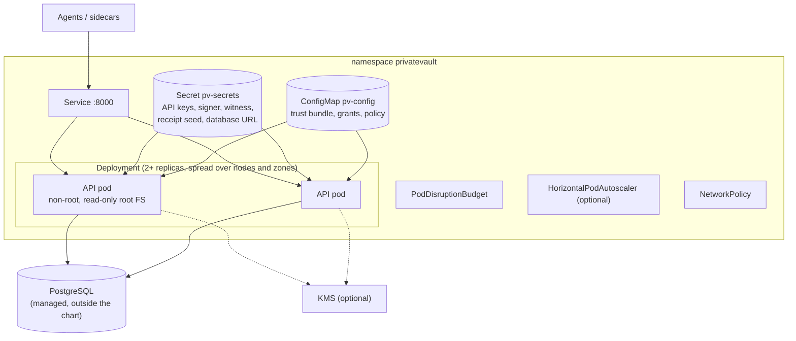
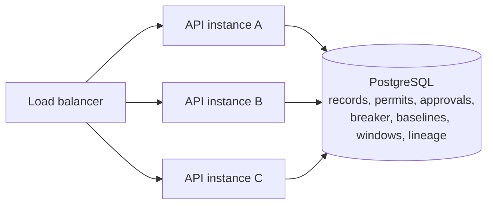

# Deployment

How the parts run. Pick the smallest shape that covers what you need to
enforce; `GET /v1/runtime` and `tools/verify_deployment.py` report what a
running deployment actually enforces.

## Shapes

| Shape | Use for | How | Ledger |
|---|---|---|---|
| Single container | Evaluation, one host | `docker-compose.yml` | SQLite volume |
| Platform | Demo with console and metrics | `docker-compose.platform.yml` (API, operator console, Prometheus; `deploy/platform`) | SQLite volume |
| Kubernetes | Production, several replicas | Helm chart `deploy/helm/privatevault` | PostgreSQL |
| Receiver side | Owner of the system of record | `network/receiver_kit` (Docker image, compose file) | Receiver's own SQLite ledger |
| Partner sandbox | Black-box partner testing | `deploy/partners/campfire-blackbox` | SQLite |

## Kubernetes (Helm chart)

- The chart creates no secrets and generates no keys; you create them once
  (`tools/init_secure_profile.py`) and the chart references them.
- It refuses to render an unsafe configuration (SQLite shared by several
  pods or autoscaled, a ledger without a volume, a secure profile without
  trusted keys or with lineage not enforced, an image without a digest):
  `deploy/helm/privatevault/ci/check-refusals.sh` checks each refusal.
- Signing keys may be KMS references instead of files
  (`deploy/helm/privatevault/ci/kms-values.yaml`).
- CI renders the chart, validates it against the Kubernetes schemas, installs
  it on a kind cluster with PostgreSQL, runs the chart's readiness test and
  `tools/verify_deployment.py` (`deploy/helm/privatevault/ci/kind-e2e.sh`).

Install steps: [deploy/helm/privatevault/README.md](../../deploy/helm/privatevault/README.md).

## Several instances

With `PV_DATABASE_URL` every instance shares one database, so each control
that must hold across instances does: one chain per agent (advisory lock),
one live permit per decision, single-use approvals and permits, breaker
budgets, behavioural baselines and cross-agent windows. Measured in
[../benchmarks/MULTI-INSTANCE.md](../benchmarks/MULTI-INSTANCE.md). Do not
run more than one instance on SQLite.

## Agent side

| Component | Runs as | Talks to |
|---|---|---|
| Connector middleware | Library inside the agent (`agent_dna/connector/middleware.py::ConnectorMiddleware`) | Decision API |
| MCP adapter | Library (`agent_dna/connector/adapters/mcp.py`); key in `PV_AGENT_KEY` | Decision API |
| Inline MCP gateway | Process between MCP client and server (`python -m agent_dna.gateway`) | Decision API, upstream MCP server |
| Exact-byte sidecar | In process today; for complete mediation, a separately isolated sole-egress service | Receiver gate or upstream API |
| Coding-agent gate | npm package `privatevault-gate/` | Decision API |

A sidecar only mediates what is routed through it. Network policy that
denies the agent every other outbound path is part of the deployment, not
of this code.

## Receiver side

The owner of the system of record runs `network/receiver_kit` in front of
the API it protects. It needs the issuer's public keys (or trust bundle),
its own receipt key, a ledger path, its destinations, and for presenter
binding a client CA for mTLS. Quick start:
[network/receiver_kit/QUICKSTART.md](../../network/receiver_kit/QUICKSTART.md).
The gate refuses everything when its revocation list copy is stale, so it
must reach `GET /v1/revocations`.

## Operations

| Task | Where |
|---|---|
| Check a running deployment | `tools/verify_deployment.py` |
| Backups and restores | [../operations/BACKUP.md](../operations/BACKUP.md) |
| Readiness and liveness | `GET /ready`, `GET /health` |
| Metrics | `GET /metrics` (Prometheus), `deploy/platform/prometheus.yml` |
| Release | [../RELEASE-CHECKLIST.md](../RELEASE-CHECKLIST.md) |
| Hardening status | [../PRODUCTION-HARDENING.md](../PRODUCTION-HARDENING.md) |
