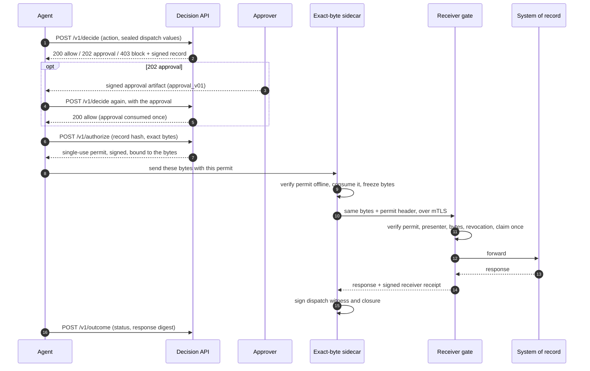
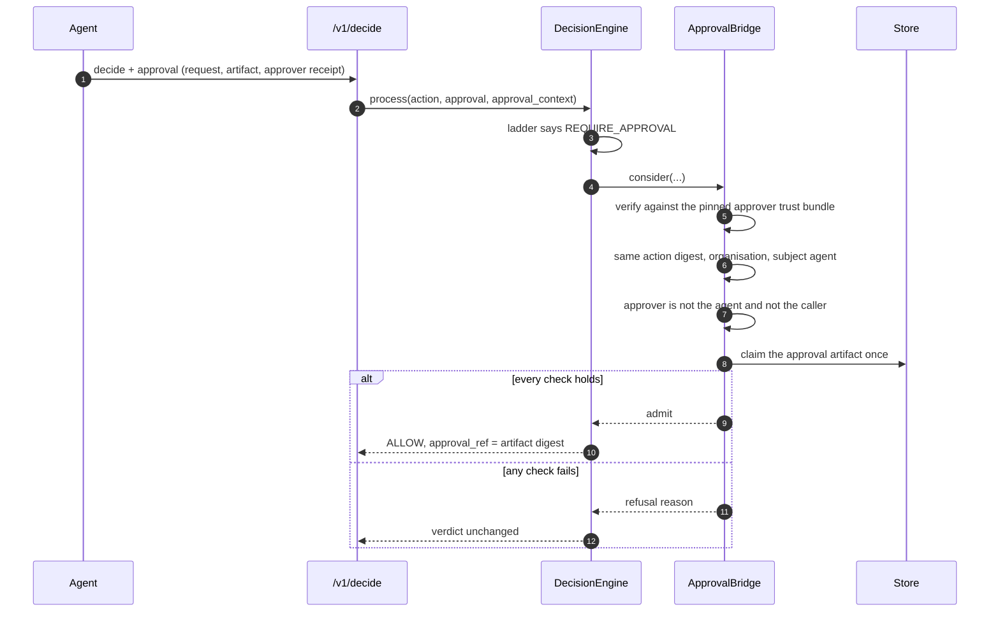
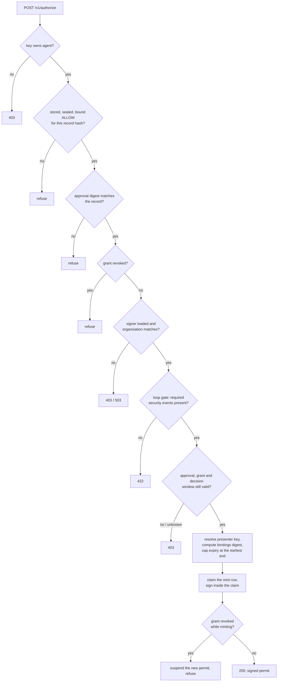
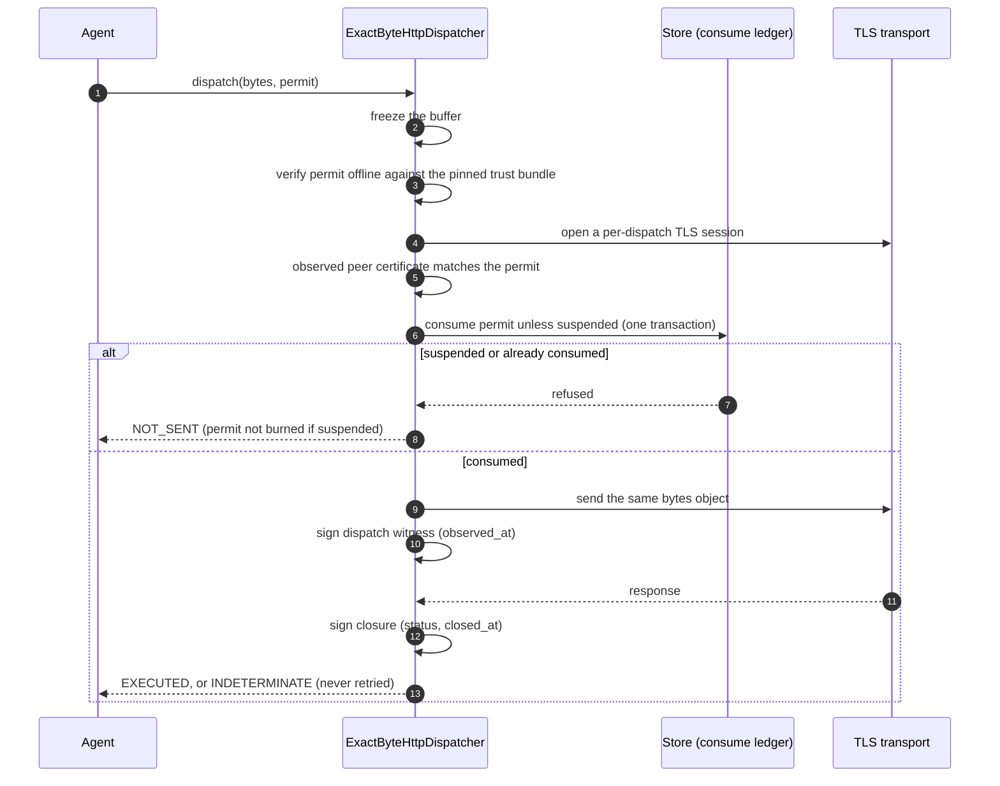
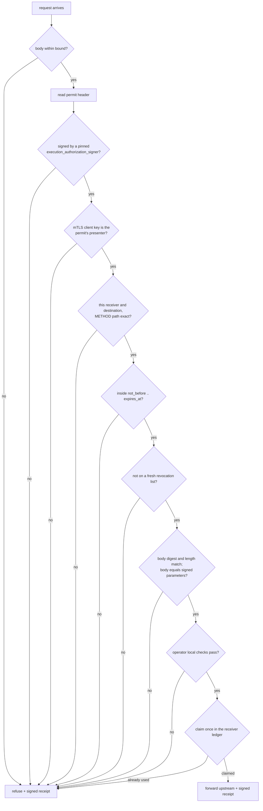
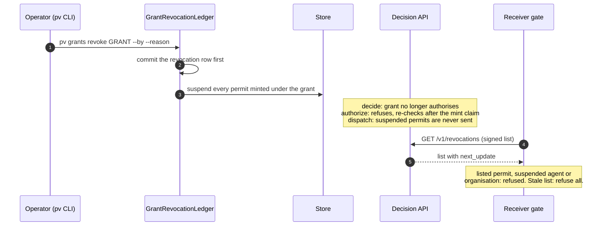
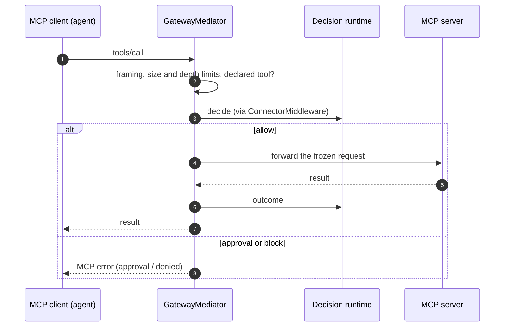
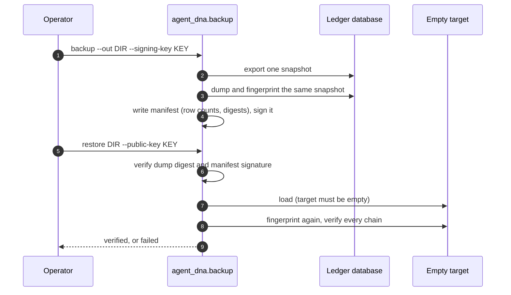

# Flows

What happens, in order, for each thing PrivateVault does. Every step names
the function that does it; `tests/test_architecture_doc.py` fails if any of
those names stops existing. For one `/v1/decide` call in full detail (monitor,
breaker, ladder) see [../../ARCHITECTURE.md](../../ARCHITECTURE.md).

Separation holds only for covered flows where enforcement is enabled and
verified.

## The whole path of a state-changing action

Each box can run without the next one: a deployment can decide without
minting, mint without a receiver gate, and so on. What is enforced is what is
attached; `GET /v1/runtime` reports it.

## HTTP routes

Every route `api/server.py` serves. `test_every_route_is_documented` fails if
a route is added without a row here.

| Method and path | Handler | Key | What it does |
|---|---|---|---|
| `POST /v1/decide` | `api/server.py::decide` | full | Decide one action, seal and sign the record |
| `POST /v1/outcome` | `api/server.py::outcome` | full | Append what happened after an ALLOW |
| `POST /v1/authorize` | `api/server.py::authorize` | full | Mint a single-use permit for a sealed, bound ALLOW |
| `GET /v1/runtime` | `api/server.py::runtime_composition` | full | Which enforcement levels are attached, and why the rest are not |
| `GET /v1/records/{agent_id}` | `api/server.py::records` | full (own agent) | That agent's records |
| `GET /v1/blocked` | `api/server.py::blocked` | full (own agent) | Blocked records |
| `GET /v1/divergent` | `api/server.py::divergent` | full (own agent) | BLOCKed records the executor reported as executed anyway |
| `GET /v1/lineage/{decision_id}` | `api/server.py::lineage` | full (own agent) | Server-derived lineage of a decision (ADR 0021) |
| `GET /v1/revocations` | `api/server.py::revocations` | audit or full | Signed revocation list for receivers |
| `GET /v1/flows/{flow_id}` | `api/server.py::flow_export` | audit or full | Every record in one multi-agent flow |
| `GET /v1/envelope/{record_hash}` | `api/server.py::envelope` | full | Signed envelope of one record |
| `GET /v1/verify` | `api/server.py::verify` | audit or full | Re-verify every chain in the store |
| `GET /v1/audit/export` | `api/server.py::audit_export` | audit or full | All records as JSONL |
| `GET /v1/audit/envelopes` | `api/server.py::audit_envelope_export` | audit or full | All envelopes as JSONL |
| `GET /v1/ops/summary` | `api/server.py::ops_summary` | audit or full | Counts for the operator console |
| `GET /` | `api/server.py::root` | none | Service description |
| `GET /health` | `api/server.py::health` | none | Process is up |
| `GET /ready` | `api/server.py::ready` | none | Store answers a ping; reports auth and signing posture |
| `GET /metrics` | `api/server.py::prometheus_metrics` | none | Prometheus metrics |

"full" is an operator or agent key; "own" means the key must own the
agent. An audit-scoped key reads only the audit routes; it cannot decide,
mint or report outcomes (`api/server.py::require_api_key`).

## Decide

Covered in full in [../../ARCHITECTURE.md](../../ARCHITECTURE.md). The order
inside `api/server.py::decide`:

1. Key to principal, and the key must own `agent_id`
   (`api/server.py::_enforce_identity`); DRP 0.2 binding checks
   (`api/server.py::_validate_decide_binding`).
2. An approval, if one is attached, is checked for whether it can be judged
   at all (`api/server.py::_approval_context_for`).
3. The sealed destination and operation are exposed to policy as
   `evidence.bound`; callers cannot set it themselves.
4. Monitor, breaker, engine and precedence ladder
   (`agent_dna/runtime.py::RuntimeMonitor.process`).
5. Cross-agent escalation (`agent_dna/connector/cross_agent.py::escalate_with_cross_agent`)
   and lineage escalation (`agent_dna/lineage.py::escalate_with_lineage`).
   Both can only tighten.
6. Seal, sign and store record and envelope together
   (`agent_dna/decision_recorder.py::DecisionRecorder.record`), then record
   the lineage event (`agent_dna/lineage.py::LineageLedger.record`).
7. HTTP status from the verdict: 200 allow, 202 approval, 403 block.

## Approval (ADR 0020)

| Step | Code |
|---|---|
| Engine hands the approval to the bridge | `agent_dna/decision.py::DecisionEngine._apply_approval` |
| All checks | `agent_dna/approval_bridge.py::ApprovalBridge.consider` |
| Single-use claim | `agent_dna/sqlite_store.py::SQLiteDecisionStore.try_consume_approval` |

An approval never overrides BLOCK and is never consumed by a decision that
was already ALLOW.

## Authorize: minting a permit

`api/server.py::authorize` refuses unless every step passes, in this order:

| Step | Code |
|---|---|
| Sealed ALLOW lookup | `api/server.py::_require_sealed_allow_for_authorize` |
| Revoked grant | `api/server.py::_revoked_grant_for` |
| Signer (local seed or KMS) | `api/server.py::_pv_load_signer` |
| Authority still valid; permit expiry capped (ADR 0024) | `agent_dna/authority_deadline.py::authority_deadline` |
| Presenter key for mTLS (ADR 0022) | `api/server.py::_resolve_presenter` |
| What the permit binds | `agent_dna/authorize_binding.py::mint_bindings_digest` |
| One live permit per decision (ADR 0016) | `agent_dna/sqlite_store.py::SQLiteDecisionStore.claim_or_replay_mint`, `agent_dna/pg_store.py::PostgresDecisionStore.claim_or_replay_mint` |

A repeat call with the same bindings returns the same permit; a call with
different bindings for the same decision is refused.

## Dispatch: the exact-byte sidecar

`agent_dna/connector/adapters/exact_byte_http.py::ExactByteHttpDispatcher.dispatch`.
Order is fixed and fails closed; nothing goes on the wire until the permit
has verified and been consumed.

| Step | Code |
|---|---|
| Frozen dispatch | `agent_dna/connector/adapters/exact_byte_http.py::ExactByteHttpDispatcher._dispatch_frozen` |
| Pinned verification | `agent_dna/connector/adapters/exact_byte_http.py::ExactByteHttpDispatcher._verify_pinned` |
| Consume unless suspended | `agent_dna/connector/adapters/exact_byte_http.py::ExactByteHttpDispatcher._consume`, `agent_dna/sqlite_store.py::SQLiteDecisionStore.try_consume_unless_suspended` |
| Send and witness | `agent_dna/connector/adapters/exact_byte_http.py::ExactByteHttpDispatcher._transmit_and_attest`, `agent_dna/connector/adapters/exact_byte_http.py::ExactByteHttpDispatcher._attest_after_send` |
| Closure | `agent_dna/connector/adapters/exact_byte_http.py::ExactByteHttpDispatcher._sign_closure` |
| Trust bundle rules (witness key may not also mint, ADR 0009) | `agent_dna/connector/adapters/execution_trust.py::validate_execution_trust_bundle` |

The sidecar is a control on the agent's side of the wire. An agent that holds
the upstream credentials and calls the API directly never meets it; that is
what the receiver gate is for.

## Receiver gate (ADR 0019)

Runs at the system of record, operated by its owner.
`agent_dna/receiver/gate.py::ReceiverGate.check` admits a request only if the
permit it carries verifies offline and binds what actually arrived:

| Step | Code |
|---|---|
| Ordered checks | `agent_dna/receiver/gate.py::ReceiverGate._verify` |
| Permit header | `agent_dna/receiver/gate.py::ReceiverGate._permit_from_headers` |
| Signature and pinned key | `agent_dna/receiver/gate.py::ReceiverGate._verify_trust` |
| Presenter (mTLS) | `agent_dna/receiver/gate.py::ReceiverGate._verify_presenter` |
| Revocation list | `agent_dna/receiver/gate.py::ReceiverGate._verify_not_revoked` |
| Single-use claim and receipt | `agent_dna/receiver/gate.py::ReceiverGate._admit`, `agent_dna/receiver/ledger.py::ReceiverLedger.record` |
| HTTP server around the gate | `network/receiver_kit/app.py` |

A wrong presenter is refused before the ledger, so the permit is not burned.
Every evaluated request, admitted or refused, gets a signed, hash-chained
receipt. The gate protects only operations routed through it; coverage is a
deployment property.

## Outcome

`api/server.py::outcome` checks the caller owns the decision, refuses
`status=ok` without `dispatched=true`, then appends an execution event to the
same chain (`agent_dna/decision_recorder.py::DecisionRecorder.report_outcome`).
A BLOCKed decision that the executor reports as executed anyway shows up
in `GET /v1/divergent`.

## Grant revocation

| Step | Code |
|---|---|
| CLI | `agent_dna/cli.py::cmd_grants_revoke`, `agent_dna/cli.py::cmd_grants_revoked` |
| Revoke and suspend | `agent_dna/grant_revocation.py::GrantRevocationLedger.revoke`, `agent_dna/pg_store.py::PostgresGrantRevocationLedger.revoke` |
| Signed list | `agent_dna/revocation_list.py::build_revocation_list` |
| Receiver's copy (no rollback, fails closed when stale) | `agent_dna/revocation_list.py::RevocationListCache.update`, `agent_dna/revocation_list.py::RevocationListCache.refresh` |

The CLI needs the database, never an agent API key. Actions dispatched before
the revocation committed are not reversed.

## Inline MCP gateway

`python -m agent_dna.gateway` sits between an MCP client and an MCP server.
For each tools/call request it decides, freezes the arguments, forwards only the
frozen bytes, and reports the outcome.

| Step | Code |
|---|---|
| Message dispatch | `agent_dna/gateway/mediator.py::GatewayMediator.handle_message` |
| Decide and freeze | `agent_dna/gateway/mediator.py::GatewayMediator.prepare_tools_call` |
| Forward | `agent_dna/gateway/mediator.py::GatewayMediator.forward_pending` |
| Decide and outcome client | `agent_dna/connector/middleware.py::ConnectorMiddleware` |

Redirects, sampling requests, undeclared tools, mutated arguments and a
changed upstream principal are refused.

## Audit connector

`python -m agent_dna.audit_connector` is a read-only MCP server (OAuth in
front) that lets an auditor, for example Claude, query the decision API with
an audit key.

| Tool | Code |
|---|---|
| Blocked actions | `agent_dna/audit_connector/server.py::AuditTools.list_blocked_actions` |
| One agent's actions | `agent_dna/audit_connector/server.py::AuditTools.list_agent_actions` |
| One decision | `agent_dna/audit_connector/server.py::AuditTools.get_decision` |
| Verify the trail | `agent_dna/audit_connector/server.py::AuditTools.verify_audit_trail` |
| Activity summary | `agent_dna/audit_connector/server.py::AuditTools.activity_summary` |
| Revocations | `agent_dna/audit_connector/server.py::AuditTools.list_revocations` |
| Server with OAuth | `agent_dna/audit_connector/server.py::build_oauth_server` |

## Offline verification

Anyone with the exported files and the public keys can check them. The
verifiers use the standard library only and never import `agent_dna`.

| What | Tool |
|---|---|
| Decision records and envelopes | `tools/verify_records.py` |
| Receiver receipts | `tools/verify_receiver_receipts.py` |
| Lineage events | `tools/verify_lineage.py` |
| A running deployment's posture | `tools/verify_deployment.py` |

The offline verifier proves integrity and server-key attestation, not
independent approval; it needs trusted keys and identity bindings.

## Backup and restore

| Step | Code |
|---|---|
| SQLite | `agent_dna/backup.py::backup_sqlite` |
| PostgreSQL | `agent_dna/backup.py::backup_postgres` |
| Check a backup | `agent_dna/backup.py::verify_backup` |
| Restore and prove | `agent_dna/backup.py::restore` |

Runbook: [../operations/BACKUP.md](../operations/BACKUP.md).
