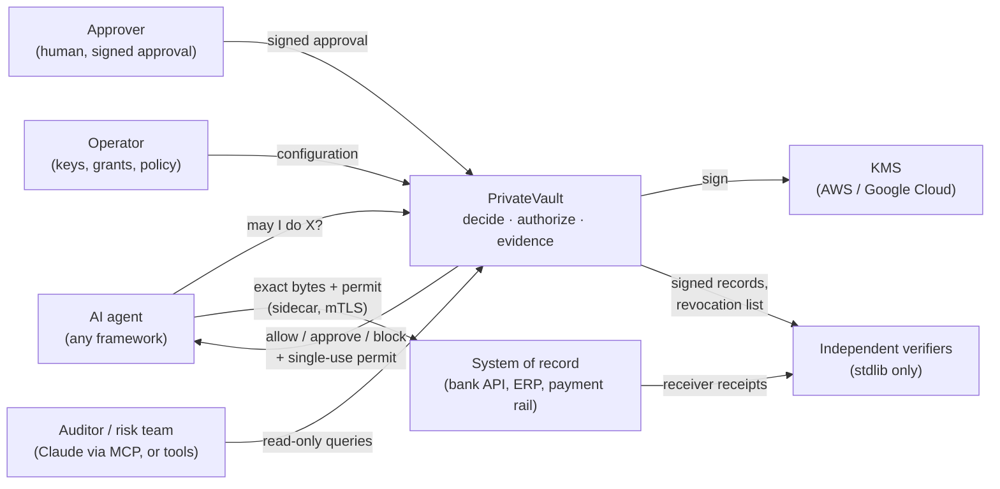
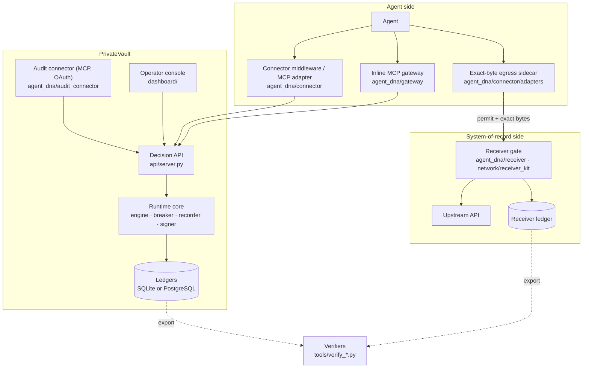
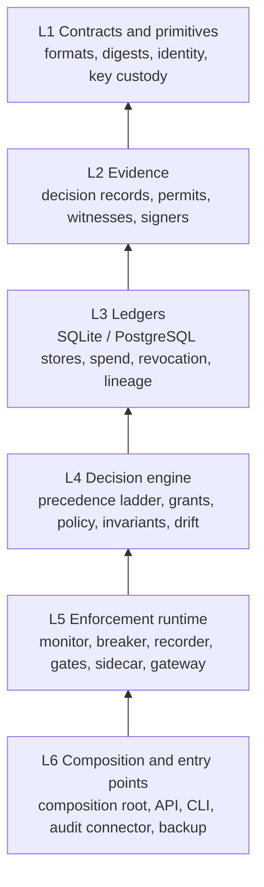

# Architecture overview

PrivateVault is an execution gate for AI agents. An agent asks before it acts;
PrivateVault decides, records the decision as signed evidence, and, for actions
that change something, issues a single-use permit that binds the exact bytes
the agent may send. Where the system of record runs a receiver gate, that gate
refuses anything without a matching permit. Every step leaves evidence that can
be checked without trusting, or even importing, this code.

Separation holds only for covered flows where enforcement is enabled and
verified.

This page is the top of the architecture docs. Each section links to the page
with the detail.

| Page | Answers |
|---|---|
| [REPO-MAP.md](REPO-MAP.md) | What every directory is, and whether it ships |
| [FLOWS.md](FLOWS.md) | What happens, step by step, for decide, authorize, dispatch, the receiver gate, revocation, approvals and audit |
| [DATA.md](DATA.md) | Every ledger table: who writes it, who reads it, SQLite or PostgreSQL |
| [TRUST-AND-KEYS.md](TRUST-AND-KEYS.md) | Every key: who holds it, what it signs, who verifies it |
| [DEPLOYMENT.md](DEPLOYMENT.md) | How the parts run: single host, Kubernetes, multi-instance, receiver side |
| [DEPENDENCIES.md](DEPENDENCIES.md) | Who depends on whom inside the code (generated) |
| [MAP.md](MAP.md) | Directory-level import graph across the whole repo (generated) |
| [../../ARCHITECTURE.md](../../ARCHITECTURE.md) | One decision end to end, the precedence ladder, trust boundaries |
| [../adr/](../adr/README.md) | Why each design decision was made |

## System context

Who and what PrivateVault talks to.

## The parts that run

| Part | Code | Ships in |
|---|---|---|
| Decision API | `api/server.py` | Docker image, Helm chart (`deploy/helm/privatevault`) |
| Runtime core, assembled once | `agent_dna/composition.py::build_production_runtime` | Python package |
| Connector middleware | `agent_dna/connector/middleware.py::ConnectorMiddleware` | Python package |
| MCP adapter | `agent_dna/connector/adapters/mcp.py` | Python package |
| Inline MCP / HTTPS gateway | `agent_dna/gateway/mediator.py::GatewayMediator` | `python -m agent_dna.gateway` |
| Exact-byte sidecar | `agent_dna/connector/adapters/exact_byte_http.py::ExactByteHttpDispatcher` | Python package |
| Receiver gate | `agent_dna/receiver/gate.py::ReceiverGate` | receiver kit image (`network/receiver_kit`) |
| Audit connector | `agent_dna/audit_connector/server.py::build_oauth_server` | `python -m agent_dna.audit_connector` |
| Operator console | `dashboard/` | static web app |
| Coding-agent gate | `privatevault-gate/` | npm package |
| Verifiers | `tools/verify_records.py`, `tools/verify_receiver_receipts.py`, `tools/verify_lineage.py` | run anywhere, standard library only |
| Rust mirror of records and signer | `rust/` | `pv_runtime` wheel |

## How the code is layered

Six responsibility layers, bottom to top; a module uses its own layer or
below. The generated [DEPENDENCIES.md](DEPENDENCIES.md) has every module, what
it imports, who imports it, and the few imports that point upward.

Three rules hold across the layers, each enforced by a test:

- **One composition root.** The API, the gateway and the connector all get
  their runtime from `agent_dna/composition.py::build_production_runtime`, so
  a transport cannot assemble a weaker stack.
- **Fail closed.** Any exception in the engine becomes a BLOCK
  (`agent_dna/decision.py::DecisionEngine.decide`); a store, signer or KMS
  failure refuses instead of answering.
- **Verification is independent.** The verifiers in `tools/` use the standard
  library only and never import `agent_dna`; only
  `agent_dna/signer_bridge.py` touches the Rust extension
  (`tests/test_architecture.py`).

## Keeping these docs true

- Every code reference in these pages (a file path, or a file path and a
  definition name) must resolve to a real file and definition
  (`tests/test_architecture_doc.py`).
- [DEPENDENCIES.md](DEPENDENCIES.md) and [MAP.md](MAP.md) are generated; CI fails
  if they are stale (`python tools/archmap.py && python tools/depmap.py`).
- Claims about what is and is not proven live in
  [../WHAT-WE-DO-NOT-CLAIM.md](../WHAT-WE-DO-NOT-CLAIM.md), not here.
