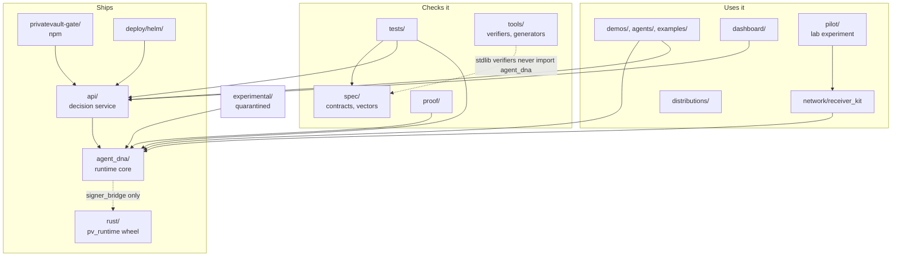

# Repository map

Every top-level entry in the repository, what it is, and whether it ships.
`test_every_top_level_entry_is_mapped` fails if a tracked top-level
directory is missing from this page.

**Status** means:

- **ships**: in the Python package (`agent_dna*`, `api*`), the Docker image,
  the Helm chart, or a published package;
- **runs**: a tool, test or kit you run, not part of the package;
- **demo**: shows the product working, with scripted or real agents;
- **reference**: data, specs or docs;
- **quarantined**: research, excluded from the package and every claim.

## How the parts relate

## Core

| Path | Status | What it is |
|---|---|---|
| `agent_dna/` | ships | Runtime core: engine, records, recorder, signers, breaker, ledgers, connector, gateway, receiver gate, audit connector, backup. Module by module: [DEPENDENCIES.md](DEPENDENCIES.md) |
| `api/` | ships | FastAPI decision service, `api/server.py` |
| `rust/` | ships | `pv_runtime`: Rust mirror of the record format and signer, byte-for-byte equal to Python (ADR 0012) |
| `spec/` | reference | Wire contracts, JSON schemas and canonical test vectors (DRP records, execution, approval, authority) |
| `tests/` | runs | The test suite; every claim names a test (ADR 0011) |
| `integrations/` | ships | Claude Code plugin (`claude-code/privatevault`): a PreToolUse hook that sends each tool call to `/v1/decide`, with a starter policy |
| `tools/` | runs | Stdlib-only verifiers, key and profile bootstrap, generators for the generated docs and pages, benchmarks, smoke tests |
| `Dockerfile` | ships | API image (`agent_dna`, `api`, `tools`, `spec`) |
| `pyproject.toml`, `requirements.txt`, `uv.lock` | ships | Package metadata and pinned dependencies |

## Deployment and partner side

Deployment assets live under `deploy/`; the receiving side of the permit
network lives under `network/`.

| Path | Status | What it is |
|---|---|---|
| `deploy/helm/` | ships | Helm chart for Kubernetes, see [DEPLOYMENT.md](DEPLOYMENT.md) |
| `deploy/platform/` | demo | Console, nginx and Prometheus config for `docker-compose.platform.yml` |
| `deploy/partners/` | runs | Partner sandbox packs (black-box test kit) |
| `docker-compose.yml`, `docker-compose.platform.yml` | runs | Single-host and platform compose files |
| `network/` | ships | Receiver kit: the system-of-record side of the permit network (`network/receiver_kit`) |
| `privatevault-gate/` | ships | npm package: MCP gate for coding agents |
| `distributions/` | ships | Standalone bundles: `pvscan` (read-only agent capability inventory) and a coding-agent evaluation harness |
| `dashboard/` | ships | Operator console: read-only web view of health, composition, blocked actions, divergence and chain state |

## Demonstrations and evidence

| Path | Status | What it is |
|---|---|---|
| `demos/` | demo | Agent checkout, live refund agent, enterprise treasury desk (real agents, real processes over HTTP) |
| `agents/` | demo | Config-driven agent template where every action goes through decide, approval and authorize |
| `examples/` | demo | Single-file demos of individual features |
| `proof/` | demo | Before/after demonstrations that the binding stops an agent with valid credentials |
| `pilot/` | runs | Lab experiment: an independent system of record as counterparty for the exact-byte adapter. Deletable; nothing in the product depends on it (`tests/test_pilot_isolation.py`) |
| `benchmarks/` | runs | Live-agent benchmark |
| `evaluation/` | runs | Adversarial and benchmark evaluation harness |
| `data/` | reference | AMLSim sample data used by examples |
| `profiles/` | reference | Sample grants and an agent profile |
| `end_to_end_coding_agents_demo.py`, `opa_decision_demo.py` | demo | Root-level demo scripts |
| `architecture.html`, `scenarios.html`, `meeting-dashboard.html`, `test-index.html` | reference | Generated HTML pages (`tools/gen_architecture.py`, `tools/gen_scenarios.py`, `tools/gen_meeting_dashboard.py`) |

## Quarantined

| Path | Status | What it is |
|---|---|---|
| `experimental/` | quarantined | Research code. Not in the package, the image, or any compliance claim |

## Repository files

| Path | What it is |
|---|---|
| `README.md` | Product overview and quick start |
| `ARCHITECTURE.md` | One decision end to end, precedence ladder, trust boundaries |
| `AGENTS.md`, `CONTRIBUTING.md` | How to work in this repository |
| `SECURITY.md`, `.well-known/` | Vulnerability reporting |
| `CHANGELOG.md` | What changed in each release |
| `LICENSE` | Licence |
| `.github/` | CI (`ci.yml`, `rust.yml`, `codeql.yml`, `policy-gate.yml`), Dependabot, PR template |
| `docs/` | Everything else: [../README.md](../README.md) |

Build output (the Rust target directory, `__pycache__`, egg-info) is never
committed; `test_no_build_output_is_tracked` checks it.
