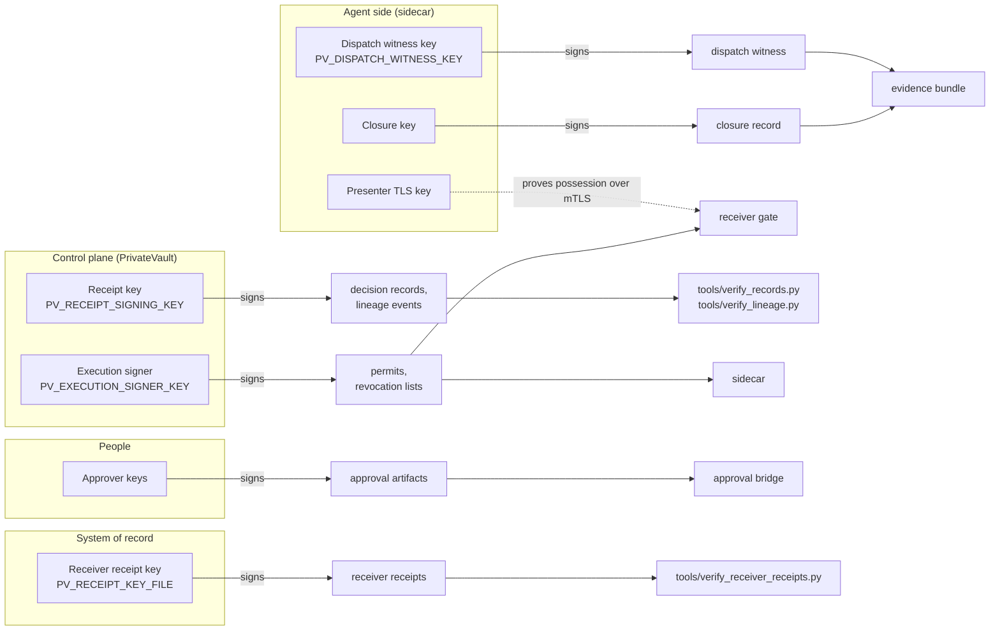

# Trust and keys

Every key in the system: who holds it, what it signs, and who checks the
signature. All signatures are pure Ed25519 (RFC 8032), so any key below can
live in a local file or in a cloud KMS (`awskms:` / `gcpkms:` references,
ADR 0023, `agent_dna/key_custody.py::kms_signer`) without changing a
verifier.

The offline verifier proves integrity and server-key attestation, not
independent approval; it needs trusted keys and identity bindings.

## Who signs what, and who checks it

| Key | Held by | Signs | Verified by | Setting |
|---|---|---|---|---|
| Receipt key | Decision API | Decision records and execution events (envelopes), lineage events | `tools/verify_records.py --trusted-key`, `tools/verify_lineage.py --trusted-key` | `PV_RECEIPT_SIGNING_KEY` (64-hex seed or KMS ref); trusted public keys in `PV_TRUSTED_PUBLIC_KEYS` |
| Execution signer (`execution_authorization_signer`) | Decision API only; never an agent process | Permits (`/v1/authorize`), signed revocation lists (`/v1/revocations`) | Sidecar, receiver gate | `PV_EXECUTION_SIGNER_KEY` (seed file or KMS ref) with its bundle in `PV_TRUST_BUNDLE`; created by `tools/init_execution_signer.py` |
| Dispatch witness key (`dispatch_witness_signer`) | Sidecar (with `PV_SECURE_PROFILE=1`, the sidecar the composition root attaches inside the API process) | Dispatch witness, after the bytes are sent | Evidence bundle verification | `PV_DISPATCH_WITNESS_KEY` |
| Closure key (`closure_signer`) | Sidecar | Closure record with the observed status | Evidence bundle verification | sidecar witness configuration |
| Approver keys (`approval_signer`) | Human approvers | Approval artifacts (approval_v01) | `agent_dna/approval_bridge.py::ApprovalBridge.consider` | Public side pinned in `PV_APPROVER_TRUST_BUNDLE` |
| Presenter TLS key | The agent's sidecar | Nothing; proves possession over mTLS | Receiver gate checks the SPKI pin named in the permit (ADR 0022) | Pins in `PV_PRESENTER_BUNDLE`; receiver trusts client certs from `PV_RECEIVER_CLIENT_CA` |
| Receiver receipt key | Receiver kit | Receiver receipts, admitted and refused | `tools/verify_receiver_receipts.py --receiver-key` | `PV_RECEIPT_KEY_FILE` |
| Backup key | Operator | Backup manifests | `agent_dna/backup.py::verify_backup` | `--signing-key` / `--public-key` |

API keys are not signing keys: they authenticate callers
(`agent_dna/apikeys.py::ApiKeyRegistry`, `PV_API_KEYS_FILE`), each with a
scope of `full` or `audit`.

## Trust bundles

A trust bundle is a signed-off list of public keys, each with its allowed
usages. Verifiers pin a bundle at startup; a caller never supplies one.

| Bundle | Pinned by | Must contain | Code |
|---|---|---|---|
| Execution trust bundle | Sidecar (`PV_EXECUTION_TRUST_BUNDLE_FILE`) | `execution_authorization_signer`, `dispatch_witness_signer`, `closure_signer`; no key may hold both of the first two (ADR 0009) | `agent_dna/connector/adapters/execution_trust.py::validate_execution_trust_bundle` |
| Issuer bundle | Receiver gate (`PV_TRUST_BUNDLE_FILE`, or derived from `PV_ISSUER_ORGANISATION` and `PV_ISSUER_KEYS`) | an `execution_authorization_signer` | `agent_dna/receiver/gate.py::ReceiverGate` |
| Approver bundle | Decision API (`PV_APPROVER_TRUST_BUNDLE`) | an `approval_signer` | `agent_dna/approval_bridge.py::ApprovalBridge` |
| Presenter bundle | Decision API (`PV_PRESENTER_BUNDLE`) | the SPKI pins an agent may present | `api/server.py::_resolve_presenter` |

Each permit names the digest of the trust bundle it was signed under, so a
verifier holding a different bundle refuses it.

## Separation that the keys enforce

- **Minting is not witnessing.** The key that mints a permit cannot also sign
  the witness that says it was sent (ADR 0009); startup refuses a bundle
  where one key holds both. Distinct keys are not distinct processes: when
  the sidecar runs inside the API process (secure profile, Helm chart), one
  process holds both keys. Complete mediation needs the sidecar deployed as
  a separately isolated, sole-egress service.
- **The agent never holds the execution signer.** `/v1/authorize` signs; an
  agent only presents it. In the Helm chart the key is a Secret mounted
  only into the API pod.
- **The approver is not the agent and not the caller.** The approval bridge
  refuses an approval signed by the requesting agent's identity or by the
  authenticated caller.
- **The receiver owns its own key and ledger.** Receipts are signed by the
  system of record, not by PrivateVault, so they are evidence PrivateVault
  cannot forge.

Separation holds only for covered flows where enforcement is enabled and
verified.

## Where keys can live

| Custody | Setting value | Code |
|---|---|---|
| Local file or seed | a path, or a 64-hex seed | `agent_dna/key_custody.py::LocalSigner` |
| AWS KMS (`ECC_NIST_EDWARDS25519`, `ED25519_SHA_512`, RAW, at most 4096 bytes) | `awskms:<key id or ARN>` | `agent_dna/key_custody.py::AwsKmsSigner` |
| Google Cloud KMS (`EC_SIGN_ED25519`, CRC32C checked) | `gcpkms:<key version name>` | `agent_dna/key_custody.py::GcpKmsSigner` |

Every KMS signature is verified locally against the key's public key before
it is used, so a wrong key or algorithm fails closed. Smoke test against a
real key: `tools/kms_smoke.py`.
